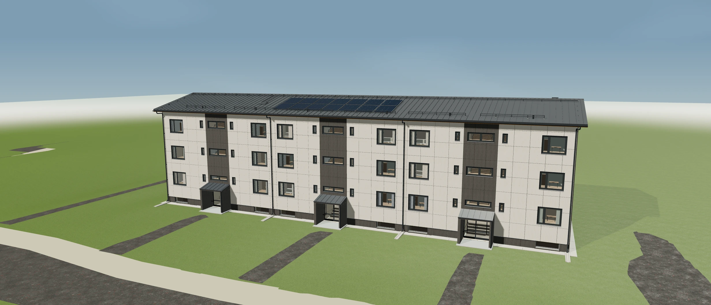

# STROIKA · architectural review viewer

<picture>
  <source media="(prefers-color-scheme: dark) and (max-width: 600px)" srcset="https://raw.githubusercontent.com/DiadkoShmek/DiadkoShmek/main/assets/identity/stroika-dark-mobile.svg">
  <source media="(max-width: 600px)" srcset="https://raw.githubusercontent.com/DiadkoShmek/DiadkoShmek/main/assets/identity/stroika-light-mobile.svg">
  <source media="(prefers-color-scheme: dark)" srcset="https://raw.githubusercontent.com/DiadkoShmek/DiadkoShmek/main/assets/identity/stroika-dark.svg">
  
</picture>

An interactive 3D view of a building and its façade details, with published model views and technical references.

**[Open the viewer →](https://diadkoshmek.github.io/mae7-viewer/)**



## Explore

- Rotate, pan and zoom the model using the on-screen controls.
- Switch between the building, façade layers, roof and plinth views.
- Use the Estonian or Ukrainian interface; inspect the published drawings and model references.

The purpose is visual review and explanation. Small details are simplified, and model dimensions do not replace site measurements or an approved construction design.

Original project files and signed documents are kept by the project owner. The public viewer contains model material and review drawings.

## This repository

A public browser release built with JavaScript and Three.js. [Release identity](STATIC_RELEASE.json) records the source commit and model identity. This overview does not change the model, calculations or application code.

To serve a checkout locally, use Python 3:

```bash
python3 -m http.server 8874 --bind 127.0.0.1
```

Open **http://127.0.0.1:8874/** in a browser with WebGL support. Serve over HTTP rather than opening the HTML file directly.

## Українською

Інтерактивна модель для огляду будівлі, фасадних шарів і деталей. Візуалізація допомагає пояснювати проєктні рішення, але не є підтвердженням точності обмірів чи дозволом на виконання будівельних робіт.

[Project index](https://github.com/DiadkoShmek) · [External results](https://github.com/DiadkoShmek/DiadkoShmek/blob/main/RESULTS.md)
